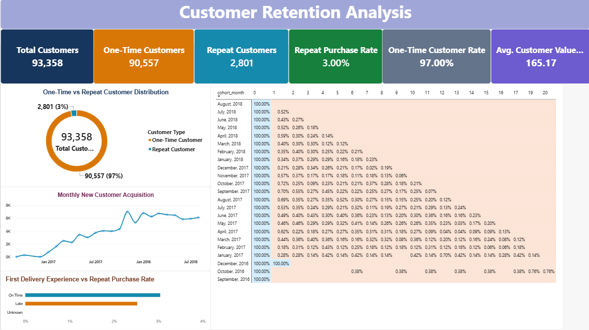
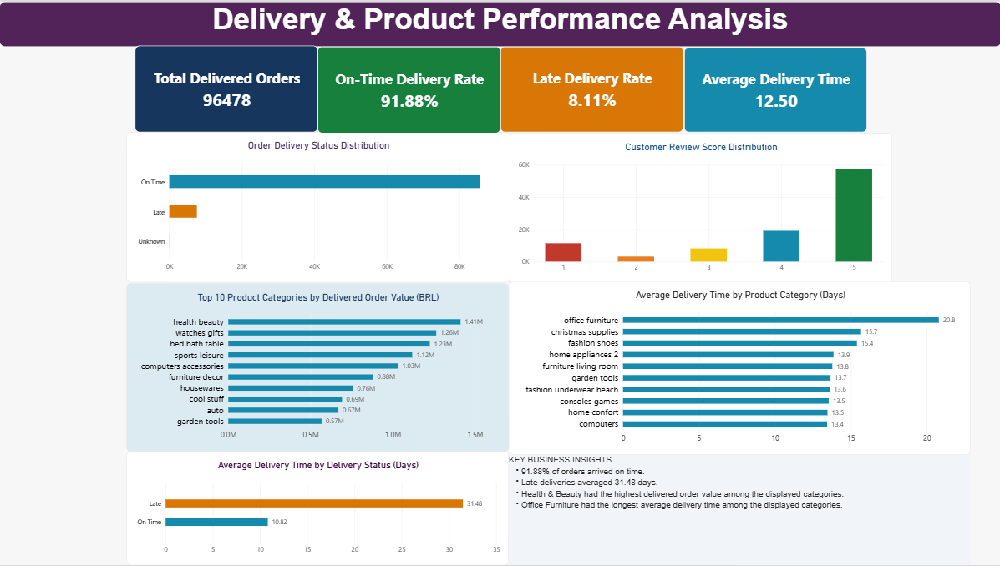
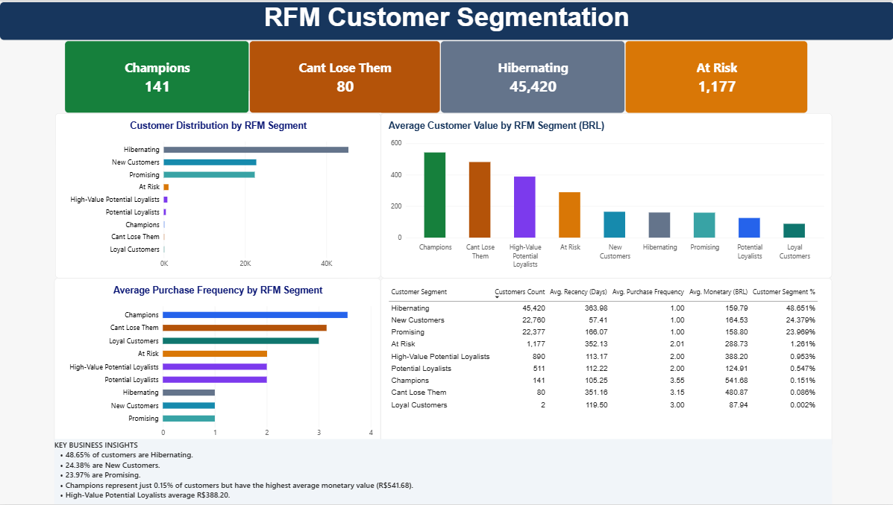

# Olist E-Commerce Customer Retention Analysis

## Project Overview

This project analyzes the Brazilian Olist E-Commerce public dataset to understand customer purchasing behaviour, repeat purchases, customer retention, RFM segmentation, and delivery performance.

Using MySQL and Power BI, the project transforms raw e-commerce data into actionable business insights. The primary objective is to understand why customers do not return after their first purchase and identify opportunities to improve customer retention and business performance.

## Business Objectives

- Analyze customer purchasing behaviour and repeat purchase patterns.
- Measure customer retention and repeat purchase rates.
- Perform monthly cohort analysis to understand customer retention over time.
- Segment customers using Recency, Frequency, and Monetary (RFM) analysis.
- Evaluate delivery performance and customer review scores.
- Identify high-value, at-risk, and inactive customer segments.
- Build interactive Power BI dashboards to communicate business insights.

## Tools & Technologies

| Tool | Purpose |
|---|---|
| MySQL 8.0 | Database management, SQL queries, joins, and analysis |
| MySQL Workbench | Database creation, CSV imports, and query execution |
| Power BI | Interactive dashboards and business reporting |
| Power Query | Data transformation and preparation |
| DAX | KPI calculations and dashboard measures |
| Excel / CSV | Data inspection and result exports |

## Dataset Information

**Dataset:** Brazilian E-Commerce Public Dataset by Olist.

The project uses nine relational tables:

1. Customers
2. Orders
3. Order Items
4. Order Payments
5. Order Reviews
6. Products
7. Sellers
8. Geolocation
9. Product Category Translation

The dataset contains approximately 100,000 order records and related customer, product, seller, payment, and delivery information.

## Project Structure

```text
olist-ecommerce-customer-retention-analysis/
│
├── sql/
│   ├── 01_schema.sql
│   ├── 02_data_validation.sql
│   ├── 03_customer_analysis.sql
│   ├── 04_repeat_purchase.sql
│   ├── 05_cohort_analysis.sql
│   ├── 06_delivery_review_analysis.sql
│   └── 07_rfm_segmentation.sql
│
├── powerbi/
│   ├── olist_dashboard.pbix
│   └── screenshots/
│       ├── page1_customer_retention.png
│       ├── page2_rfm_segmentation.png
│       └── page3_delivery_product_performance.png
│
├── data/
│   └── README.md
│
└── README.md
```

*Note: Include only files and folders that actually exist in your repository. Do not upload the original dataset files if their redistribution is restricted.*

## SQL Analysis

| Analysis | Description |
|---|---|
| Database Schema | Created and inspected nine relational tables |
| Data Validation | Checked row counts, duplicate records, and missing values |
| Customer Analysis | Identified unique customers and purchasing behaviour |
| Repeat Purchase Analysis | Measured one-time and repeat customers |
| Cohort Analysis | Analyzed monthly customer repeat activity |
| Delivery Analysis | Evaluated delivery status and delivery duration |
| Review Analysis | Examined customer review score distribution |
| RFM Segmentation | Classified customers using RFM scores and business rules |

### SQL Concepts Used

- INNER JOIN and LEFT JOIN
- GROUP BY and aggregate functions
- Common Table Expressions (CTEs)
- Subqueries
- Window Functions
- CASE statements
- Date and time functions
- Data validation
- Customer segmentation

## Key Business Findings

### 1. Customer Retention Analysis

| Metric | Result |
|---|---:|
| Total customer records | 99,441 |
| Unique customers (all orders) | 96,096 |
| Customers with delivered orders | 93,358 |
| Total delivered orders | 96,478 |
| One-time delivered customers | 90,557 |
| Repeat delivered customers | 2,801 |
| Repeat purchase rate | 3.00% |
| One-time customer rate | 97.00% |

**Key Insights:**

- Only 3.00% of customers with delivered orders made repeat purchases.
- 97.00% of delivered customers purchased only once.
- The median interval between repeat delivered purchases was 29 days.
- The average interval between repeat delivered purchases was approximately 79.15 days.

### 2. RFM Customer Segmentation

Developed a rule-based RFM model using:

- **Recency:** Days since the customer's last delivered purchase.
- **Frequency:** Number of delivered orders.
- **Monetary:** Total delivered order value, including item prices and freight.

A total of 93,358 delivered customers were classified into nine populated segments.

| Customer Segment | Customers | Percentage |
|---|---:|---:|
| Hibernating | 45,420 | 48.65% |
| New Customers | 22,760 | 24.38% |
| Promising | 22,377 | 23.97% |
| At Risk | 1,177 | 1.26% |
| High-Value Potential Loyalists | 890 | 0.95% |
| Potential Loyalists | 511 | 0.55% |
| Champions | 141 | 0.15% |
| Can't Lose Them | 80 | 0.09% |
| Loyal Customers | 2 | 0.002% |

**Key Insights:**

- Hibernating customers represent approximately 48.65% of the delivered customer base.
- New Customers account for approximately 24.38%.
- Champions represent a small segment of 141 customers.
- The large Hibernating segment highlights a significant customer reactivation opportunity.

*RFM segment labels are based on the project's defined scoring rules and are not universal industry classifications.*

### 3. Monthly Cohort Analysis

Performed monthly cohort analysis using customers' first delivered purchase month.

**Key Insights:**

- Monthly repeat activity was low across the analyzed cohorts.
- Month 1 repeat activity remained below 1% across the major cohorts.
- The highest observed Month 1 activity among the major cohorts was approximately 0.72%.
- Recent cohorts have incomplete observation periods, so future cohort months should not be interpreted as zero retention.

### 4. Delivery Performance Analysis

| Delivery Status | Orders | Percentage |
|---|---:|---:|
| On Time | 88,644 | 91.88% |
| Late | 7,826 | 8.11% |
| Unknown | 8 | 0.01% |
| **Total** | **96,478** | **100%** |

Average delivery time:

| Delivery Status | Average Delivery Days |
|---|---:|
| On Time | 10.82 |
| Late | 31.48 |
| Overall weighted average | Approximately 12.50 |

**Key Insights:**

- 91.88% of delivered orders arrived on time.
- 8.11% of delivered orders were late.
- Late deliveries took approximately 2.91 times as long as on-time deliveries.

### 5. Customer Review Analysis

Analyzed review score distribution across the available review records.

**Key Insights:**

- Five-star reviews represent the largest review category.
- Four-star reviews are the second-largest category.
- Lower review scores provide opportunities to investigate customer complaints and service issues.

### 6. Product Category Performance

Analyzed delivered order value and average delivery time across product categories.

**Top categories by delivered order value:**

| Product Category | Delivered Order Value (BRL) |
|---|---:|
| Health & Beauty | 1.41M |
| Watches & Gifts | 1.26M |
| Bed Bath Table | 1.23M |
| Sports & Leisure | 1.12M |
| Computers & Accessories | 1.03M |

**Delivery Time Insights:**

- Office Furniture had the longest average delivery time among the displayed categories, at approximately 20.8 days.
- Christmas Supplies and Fashion Shoes also showed relatively high average delivery times.

*Delivered order value is calculated using item price plus freight. It represents a delivered GMV-like measure, not net revenue or profit.*

## Power BI Dashboards

The Power BI report contains three analytical pages.

### Page 1 — Customer Retention Analysis

- Customer purchase distribution
- One-time versus repeat customers
- Monthly new customer acquisition
- Monthly cohort retention matrix
- Repeat purchase behaviour

### Page 2 — RFM Customer Segmentation

- RFM customer segment distribution
- Champions, At Risk, Hibernating, and Can't Lose Them KPIs
- Average customer value by segment
- Average purchase frequency by segment
- Customer segment summary table
- Key business insights

### Page 3 — Delivery & Product Performance Analysis

- Total delivered orders
- On-time delivery rate
- Late delivery rate
- Average delivery time
- Order delivery status distribution
- Customer review score distribution
- Top 10 product categories by delivered order value
- Average delivery time by product category

## Dashboard Screenshots

### Page 1 — Customer Retention Analysis



### Page 2 — RFM Customer Segmentation



### Page 3 — Delivery & Product Performance Analysis



## Business Recommendations

1. **Customer Reactivation:** Develop targeted campaigns for Hibernating customers.
2. **Customer Retention:** Encourage second purchases through relevant offers and follow-up campaigns.
3. **High-Value Customer Management:** Focus on Champions and customers with high monetary value.
4. **Delivery Optimization:** Investigate logistics bottlenecks and reduce late deliveries.
5. **Customer Satisfaction:** Analyze low review scores to identify recurring service problems.
6. **Product Category Monitoring:** Monitor category-level order value and delivery duration to identify operational improvement opportunities.

## How to Run This Project

1. Clone or download this repository.
2. Download the Brazilian E-Commerce Public Dataset by Olist.
3. Create the `olist_analysis` database in MySQL.
4. Create the required nine relational tables.
5. Import the CSV files into their corresponding tables.
6. Execute the SQL scripts in the recommended order.
7. Open the Power BI `.pbix` file.
8. Configure the data source if necessary and refresh the report.

## Skills Demonstrated

- MySQL and SQL Data Analysis
- Relational Database Design
- Data Cleaning and Validation
- Common Table Expressions
- Window Functions
- Customer Retention Analysis
- Cohort Analysis
- RFM Customer Segmentation
- Business Intelligence
- Power BI and DAX
- Data Visualization
- Business Insight Generation

## Author

**Md Sami Ahmad**

B.Tech – Computer Science and Engineering  
IIMT College of Engineering, Greater Noida

Interested in Data Analytics, Business Intelligence, and Data-Driven Decision Making.

---

*This project was developed as a practical data analytics portfolio project using the Brazilian Olist E-Commerce public dataset.*
